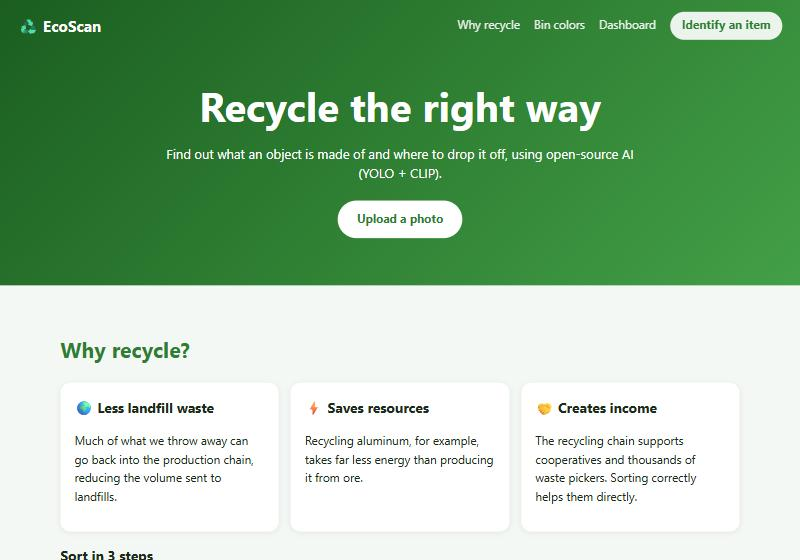
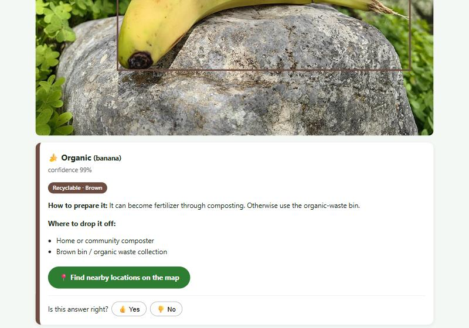
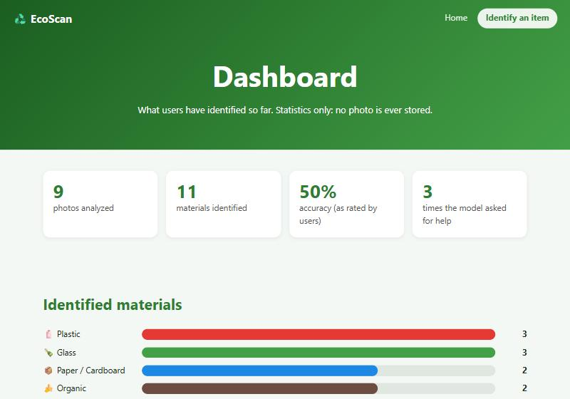
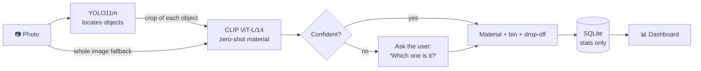

<div align="center">

# ♻️ EcoScan

**Snap a photo. Find out what it's made of. Learn where to recycle it.**

An image-based recycling assistant powered by open-source computer vision (YOLO + CLIP), with a public statistics dashboard.




</div>

---

## ✨ Features

- 🔍 **Material identification from a photo:** plastic, glass, metal, paper/cardboard, electronics, organic waste and ceramics.
- 🗑️ **Actionable guidance:** bin color, how to prepare the item and where to drop it off, with a map search for your city.
- 🤔 **Clarification questions:** when the model is unsure, it asks *"Which of these is your item?"* instead of guessing.
- 👍 **User feedback:** every answer can be confirmed or corrected, which feeds the accuracy statistics.
- 📊 **Public dashboard:** see what users have identified (e.g. *"10 items were glass"*). **Only statistics are stored, never photos.**
- 🌱 **Educational page** about why recycling matters and how to sort waste.
- 🌐 **Multilingual:** English (default) and Portuguese, switchable with the **EN | PT** button. The choice is remembered in a cookie.
- 🐳 **Docker-ready:** one command runs the whole system in a container.

<div align="center">


</div>

## 🧠 How it works

Off-the-shelf detectors (COCO) only know *"bottle"*, not *"glass bottle"* vs *"plastic bottle"*, and no ready-made
waste model was accurate enough. EcoScan combines two open-source models instead:



1. **YOLO11** (Ultralytics) finds the objects and crops them.
2. **CLIP ViT-L/14** (OpenAI, MIT) scores each crop against text descriptions such as *"a glass bottle"* or *"an aluminum can"*. Probabilities from several phrases are summed per material.
3. If YOLO finds nothing usable (cans, cardboard, newspapers...), CLIP analyzes the **whole image**.
4. Low confidence, or a close second candidate, triggers the **clarification question**.

On 21 test images from Wikimedia Commons, **19 were classified correctly**. The two misses were ambiguous photos
(bales of PET bottles tied with wire). Clear plastic vs. glass is the most common confusion.

## 🚀 Quick start

Requires **Python 3.10+** and **git** (to install the CLIP package).

```bash
git clone https://github.com/<your-user>/ecoscan.git
cd ecoscan

python -m venv .venv
.venv\Scripts\activate          # Windows  (Linux/macOS: source .venv/bin/activate)
pip install -r requirements.txt

uvicorn app.main:app
```

Open **http://127.0.0.1:8000**.

> On the first run the model weights are downloaded automatically (YOLO11m ≈ 40 MB, CLIP ViT-L/14 ≈ 900 MB),
> so startup takes a while. Later runs start much faster.

### 🐳 Run with Docker

Requires [Docker](https://docs.docker.com/get-docker/) with the Compose plugin. No Python or git needed on the host.

```bash
docker compose up --build
```

Open **http://localhost:8000**.

- The image uses **CPU-only PyTorch** and **bakes the model weights in at build time**, so the container starts without downloading anything. The first build is large (a few GB) and takes a while.
- Give Docker at least **4 GB of RAM** (YOLO11m + CLIP ViT-L/14 run on CPU). For lighter machines, build with the smaller CLIP model: `CLIP_MODEL=ViT-B/16 docker compose up --build`.
- Statistics are stored in the `ecoscan-data` volume (`/data/ecoscan.db`) and survive restarts. Remove them with `docker compose down -v`.
- The container runs as a non-root user and exposes a `/healthz` endpoint used by the Docker health check.

Without Compose:

```bash
docker build -t ecoscan .
docker run -p 8000:8000 -v ecoscan-data:/data ecoscan
```

## 🌐 Languages

English is the default. Open any page with `?lang=pt` (or use the **EN | PT** button) to switch; the choice is saved in a
`lang` cookie. The API accepts a `lang` field and returns material names, bin colors, instructions and error messages in
that language.

To add a language, add its code to `SUPPORTED` and a block to `STRINGS` in [`app/i18n.py`](app/i18n.py), and a `text`
entry per material in [`app/recycling.py`](app/recycling.py). The CLIP prompts are internal and stay in English.

## 🔌 API

| Method | Endpoint | Description |
|---|---|---|
| `GET` | `/` | Web app (`?lang=en` or `?lang=pt`) |
| `GET` | `/dashboard` | Public statistics dashboard (`?lang=en` or `?lang=pt`) |
| `POST` | `/api/analyze` | `multipart/form-data` with `image` (required), `city` and `lang` (optional). Returns the detected items, alternatives, and an annotated image |
| `POST` | `/api/feedback` | JSON `{ "id", "correct", "real_material?", "city?", "lang?" }`. One answer per detection |
| `GET` | `/api/stats` | Aggregated statistics as JSON (language-independent) |
| `GET` | `/healthz` | Health check (returns once the models are loaded) |

<details>
<summary>Example response of <code>/api/analyze</code></summary>

```json
{
  "found": true,
  "items": [
    {
      "id": "9f2c…",
      "detected_as": "bottle",
      "confidence": 0.956,
      "uncertain": false,
      "alternatives": [],
      "box": [120, 40, 410, 600],
      "material": {
        "key": "glass",
        "name": "Glass",
        "bin_color": "Green",
        "recyclable": true,
        "how_to": "Rinse it and drop it off whole…",
        "drop_off": ["Green selective-collection bin", "Recycling center"],
        "map_url": "https://www.google.com/maps/search/glass+recycling+drop-off+Curitiba"
      }
    }
  ],
  "annotated_image": "data:image/jpeg;base64,…"
}
```

</details>

## ⚙️ Configuration

Environment variables:

| Variable | Default | Description |
|---|---|---|
| `YOLO_MODEL` | `yolo11m.pt` | Any YOLO weights (e.g. `yolo11l.pt`, or a model trained on waste) |
| `CLIP_MODEL` | `ViT-L/14` | Use `ViT-B/16` for lower memory/CPU usage |
| `YOLO_CONF` | `0.25` | Minimum confidence for object detections |
| `MIN_MATERIAL_PROB` | `0.45` | Minimum confidence for the material |
| `DB_PATH` | `data/ecoscan.db` | SQLite file for statistics (`/data/ecoscan.db` in Docker) |
| `FONT_PATH` | bundled DejaVu Sans | Font used to draw labels on the annotated image (needs accented-character support) |

To add materials or tune the classification, edit `MATERIALS` and `PROMPTS` in [`app/recycling.py`](app/recycling.py).

## 🗂️ Project structure

```
app/
├── main.py          # FastAPI routes
├── classifier.py    # YOLO + CLIP pipeline
├── recycling.py     # Materials, bin colors, CLIP prompts (EN + PT texts)
├── i18n.py          # UI and API-message translations (EN default, PT)
├── db.py            # SQLite statistics (no images)
├── templates/       # index.html, dashboard.html (Jinja2)
└── static/          # CSS, vanilla JS, bundled font (DejaVu Sans)
Dockerfile           # Multi-stage image (CPU-only PyTorch, weights baked in)
docker-compose.yml   # One-command run with a persistent statistics volume
```

## 🔒 Privacy

Uploaded images are processed in memory and **never written to disk**. The database only stores the predicted
material, confidence, and the optional user feedback.

## ⚠️ Limitations

- Drop-off locations are generic guidance plus a map search link. For real addresses, integrate your municipality's recycling-point data (or OpenStreetMap's `amenity=recycling`).
- Bin colors follow Brazil's CONAMA color code, and collection rules vary by municipality.
- The dashboard and feedback endpoint are public and unauthenticated; add rate limiting before exposing them to the internet.

## 🛣️ Roadmap

- [ ] Real recycling points on a map (OpenStreetMap / Overpass API)
- [ ] Camera capture on mobile
- [ ] More materials (batteries, light bulbs, cooking oil, textiles, Tetra Pak)
- [ ] Fine-tuned model on TACO / TrashNet
- [x] Docker image
- [x] English and Portuguese interface
- [ ] More languages (Spanish...)
- [ ] Automated tests with a reference image set

## 📄 License & credits

Built with [FastAPI](https://fastapi.tiangolo.com/), [Ultralytics YOLO](https://github.com/ultralytics/ultralytics)
and [OpenAI CLIP](https://github.com/openai/CLIP). Labels drawn on images use the
[DejaVu Sans](https://dejavu-fonts.github.io/) font (license in `app/static/fonts/LICENSE-DejaVu.txt`).

> **License note:** Ultralytics is licensed under **AGPL-3.0**, which applies if you run a modified version as a
> network service. Choose a license for this repository accordingly (AGPL-3.0 is the straightforward option).
